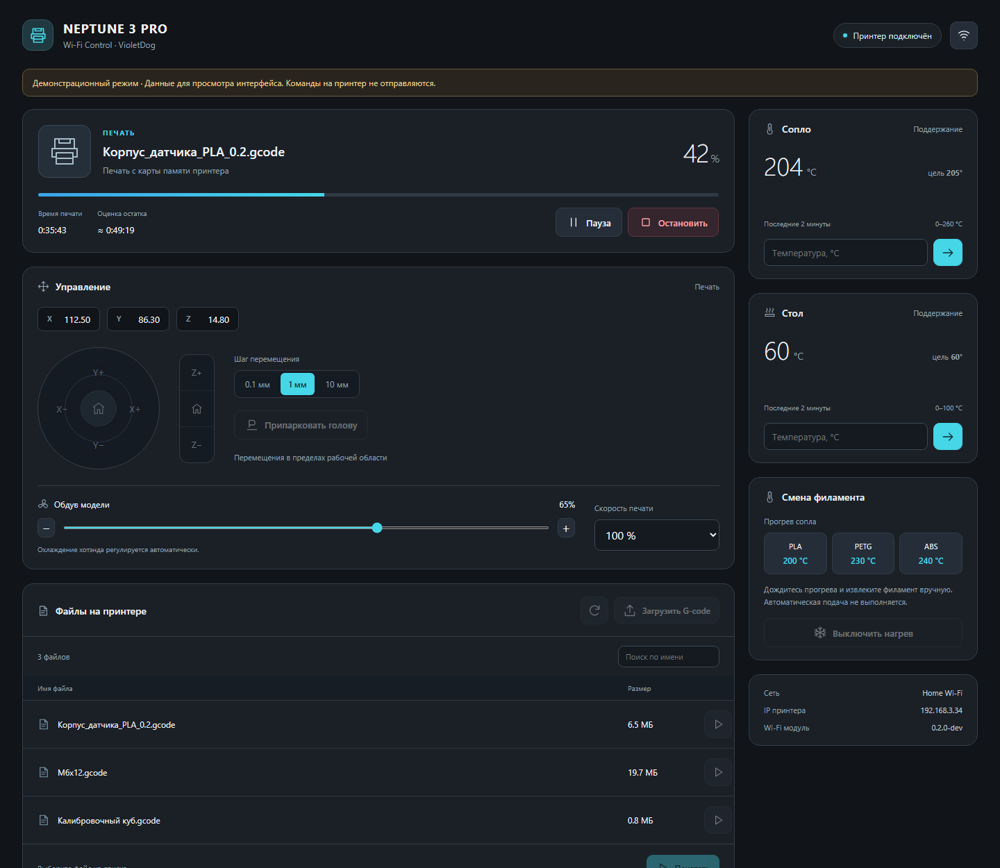
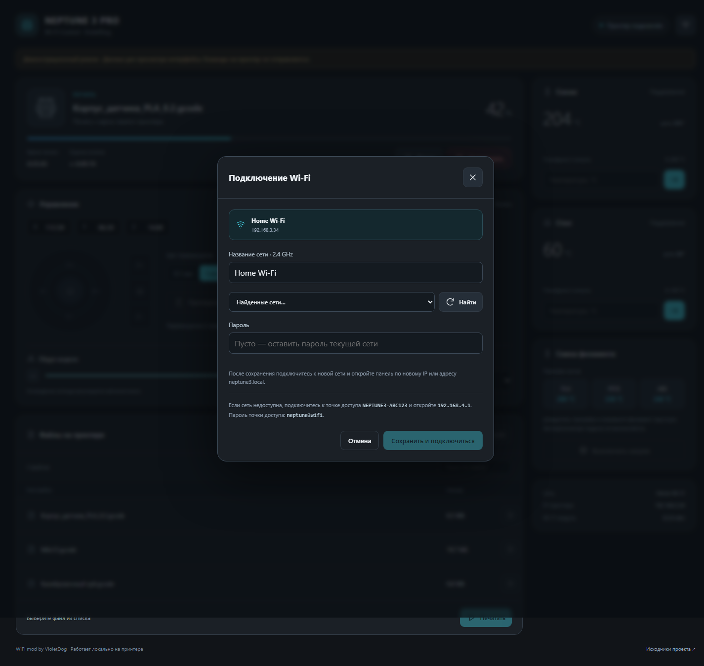
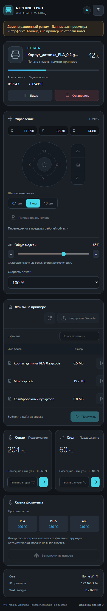
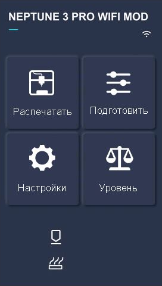
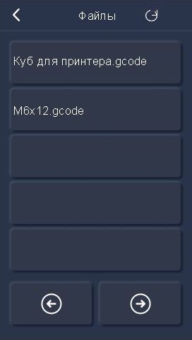
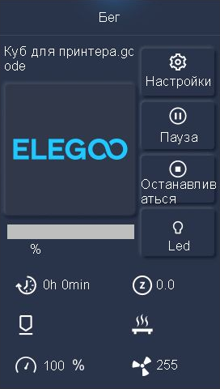
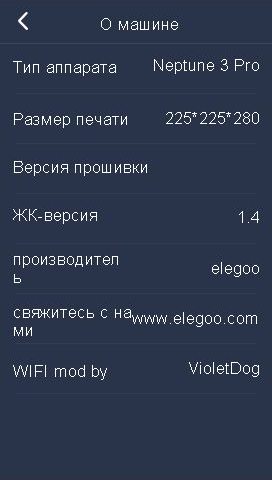

# Как выглядит модификация

**Веб-панель: демонстрационные данные, команды не отправляются. TJC: снимки официального симулятора с тестовым именем, без подключённого принтера.** Изображения показывают оформление; аппаратное испытание v0.2 ещё предстоит. Поля температуры/версии в симуляторе могут оставаться пустыми без ответа основной платы.

## Панель в браузере и вкладке слайсера

## Настройки Wi-Fi

## Мобильный браузер

## Главный экран TJC

Маленький белый значок означает подключение; без подтверждения сети он чёрный. Заголовок и авторская строка сохранены из предыдущего оформления.

## Список файлов TJC

Значок справа в заголовке обновляет список. Подпись «Файлы / Обновить» убрана; название раздела снова штатное.

## Имя текущей печати на кириллице

Длинное имя может переноситься/не помещаться в отведённое поле; исходное имя в метаданных не сокращается.

## О машине

